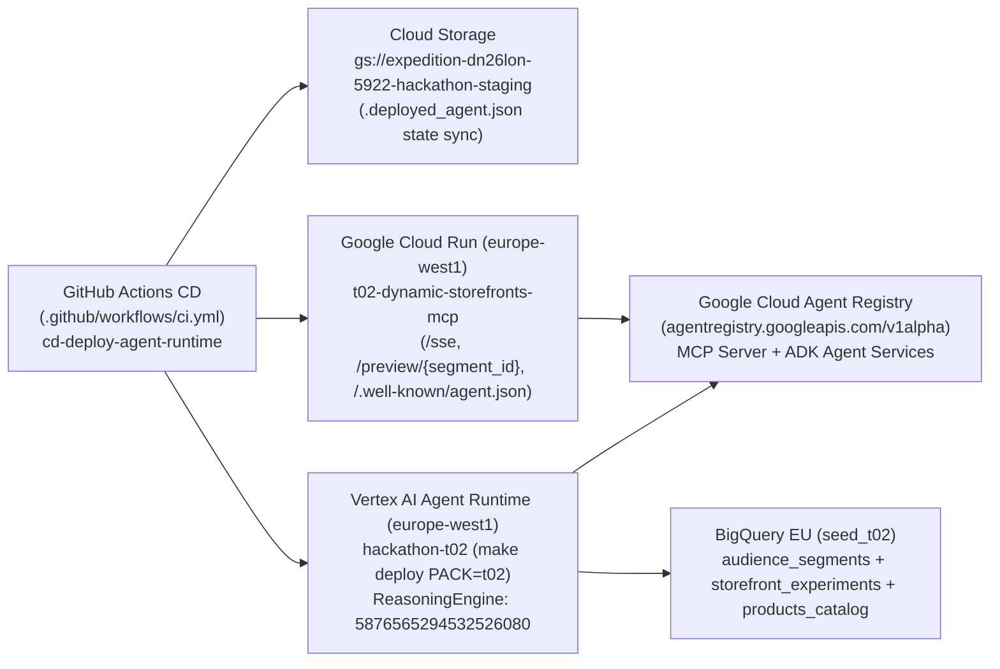

# Table 2 (`t02_dynamic_storefronts`) — Continuous Delivery (GitHub Actions + Cloud Run MCP + ADK Agent Runtime + Agent Registry)

This directory contains the Continuous Delivery (CD) components for **Table 2 — Dynamic Storefront Engine**, deployed automatically from **GitHub Actions** (`.github/workflows/ci.yml` job `cd-deploy-agent-runtime`) and **Google Cloud Build** (`cloudbuild.yaml`) using standard repository CLI commands (`make deploy PACK=t02`, `make test-remote`, `gcloud run deploy`).

---

## Architecture & Deployed Resources (`expedition-dn26lon-5922`, `europe-west1`)

| Component | Resource / Endpoint |
|---|---|
| **Cloud Run Nocturne React 19 UI + FastMCP Server** | `https://t02-dynamic-storefronts-mcp-d2lv3suxga-ew.a.run.app/ui` (`/` Root SPA) |
| **Live Bidirectional A2A JSON-RPC & Tribe Sync** | `https://t02-dynamic-storefronts-mcp-d2lv3suxga-ew.a.run.app/a2a` (`/api/a2a/sync`) |
| **FastMCP SSE Endpoint** | `https://t02-dynamic-storefronts-mcp-d2lv3suxga-ew.a.run.app/sse` |
| **Interactive Storefront Preview UI (with Lightbox)** | `https://t02-dynamic-storefronts-mcp-d2lv3suxga-ew.a.run.app/preview/SEG-001` |
| **A2A Discovery Card** | `https://t02-dynamic-storefronts-mcp-d2lv3suxga-ew.a.run.app/.well-known/agent.json` |
| **Vertex AI Agent Runtime (`ReasoningEngine`)** | `projects/633924037012/locations/europe-west1/reasoningEngines/5876565294532526080` |
| **GCS Ephemeral State Sync** | `gs://expedition-dn26lon-5922-hackathon-staging/.deployed_agent.json` |
| **Agent Registry MCP Server URN** | `urn:mcp:projects-633924037012:projects:633924037012:locations:europe-west1:agentregistry:services:t02-dynamic-storefronts-mcp` |
| **Agent Registry ADK Agent URN** | `urn:agent:projects-633924037012:projects:633924037012:locations:europe-west1:agentregistry:services:t02-dynamic-storefronts-agent` |

---

## Directory Contents

| File | Description |
|---|---|
| `cd/mcp_http_server.py` | Unified FastAPI + Starlette ASGI gateway delegating to `McpCloudRunGateway` (`mcp/http_gateway.py`), mounting `/ui` (Nocturne React 19 SPA), `/a2a` (JSON-RPC 2.0 + Tribe A2A Handshake), `/.well-known/agent.json`, `/preview/{segment_id}`, `/healthz`, and `mcp.sse_app()` (`/sse`). |
| `cd/Dockerfile.mcp` | 2-stage container image (`node:22-slim` Vite UI builder + `python:3.12-slim` runtime) copying `app/`, `mcp/` (`COPY mcp ./mcp`, `PR #58`), `seed_packs/`, `cd/`, and `/ui/dist` for Cloud Run startup. |
| `cd/cloudbuild-mcp-image.yaml` | Cloud Build configuration that builds and pushes `t02-mcp-server:latest` to Artifact Registry (`t02-mcp`). |
| `cd/register_agent_registry.py` | Idempotent registration client for `https://agentregistry.googleapis.com/v1alpha` registering both the Cloud Run MCP Server (`JSONRPC`) and the Vertex AI ADK Agent (`HTTP_JSON`). |
| `cd/deploy_cd.sh` | End-to-end CLI deployment script (`gcloud run deploy` + `make deploy PACK=t02` + `make test-remote` + `cd.register_agent_registry`). |
| `cd/cd_deployment_state.json` | Live deployment manifest with Cloud Run URLs, ReasoningEngine ID, and Agent Registry URNs. |
